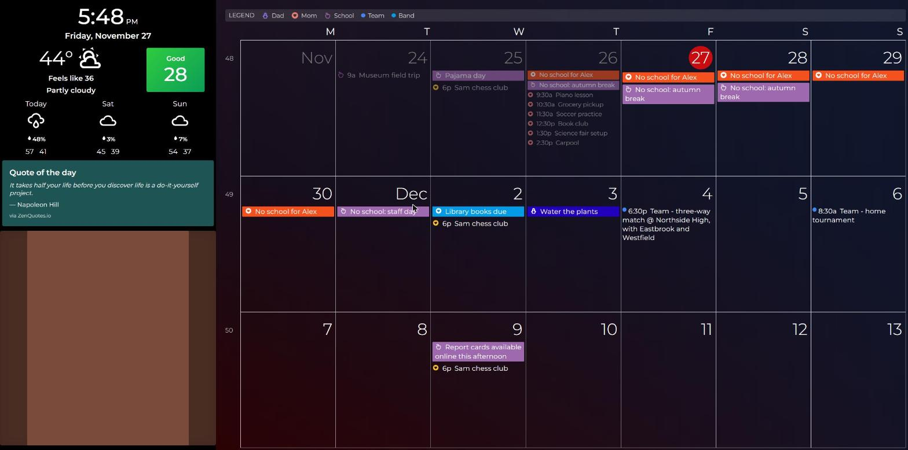

# Homeboard

A self-hosted family wall calendar: a DAKboard-style screen for Google and iCal calendars, weather and photos. It
runs as one Docker container on your own server; any browser, such as a Raspberry Pi behind a monitor, shows it.
No subscription, no cloud account of ours, and your calendars stay in your house. Not affiliated with DAKboard.



*The demo, with invented events.*

## Features

**Calendar**
- A fixed grid: the current week and the next two (1 to 6 weeks), Monday or Sunday first, with ISO week numbers.
- Several Google accounts (read-only) plus any iCal / webcal link. Each calendar gets a name, color and icon.
- Google's per-event colors where Google shares them; your own color rules by keyword otherwise.
- Full titles that wrap. Busy days shrink their text, then show "+N more". Times like `6p` or `6:00pm`.
- Shortening rules (plain text or patterns) turn "Varsity Wrestling - Dual @ North (07:00-19:30 CST)" into "VW Dual @ North".
- Past days of the current week stay visible, dimmed.

**Screen**
- Four layouts: side panel left or right, top bar, or calendar only. You choose which widgets show and in what order:
  clock, weather now, air quality, 3-day forecast, word, quote and joke of the day, photos, and your own HTML.
- Quiet mode: up to three schedules (for example school nights and weekends) dim the screen to a clock, date, next
  event or weather, at a brightness you choose.
- Restyle anything with your own CSS, built on [Open Props](https://open-props.style) design tokens. Every part has a
  stable name ([docs/CUSTOMIZE.md](docs/CUSTOMIZE.md)).
- Screens reload by themselves after an update, and keep showing the last good data if a source or the server is
  down. The board shows a notice when something has not updated for an hour.

**Running it**
- One container (`ghcr.io/joshoohaah/homeboard`, amd64 and arm64), published on every change.
- Every setting can come from compose variables, a mounted YAML/JSON file, or the admin page; compose wins and shows
  as locked on the page. Secrets can come from files (Docker secrets).
- A password-protected admin page for calendars, layout, quiet mode, alerts, shortening rules, custom CSS/HTML,
  Google sign-ins and photos.
- Home Assistant alerts when a source fails for too long, and again when it recovers.
- Photos from a folder, or picked from Google Photos and copied to your server.

## Quick start (Docker)

1. Create a folder for the data, for example `/srv/homeboard/data`, writable by user 568 (or change `user:` below).
2. Save this as `compose.yaml` and set the values:

   ```yaml
   services:
     homeboard:
       image: ghcr.io/joshoohaah/homeboard:latest
       restart: unless-stopped
       user: "568:568"
       ports:
         - "8480:8080"
       environment:
         PUBLIC_URL: http://SERVER:8480      # the address you open; https://... behind a reverse proxy
         ADMIN_PASSWORD: change-me           # for /admin
         DISPLAY_KEY: change-me-too          # open http://SERVER:8480/?key=change-me-too once per screen
         HOMEBOARD_TIMEZONE: America/Chicago
         HOMEBOARD_LATITUDE: "40.71"
         HOMEBOARD_LONGITUDE: "-74.01"
       volumes:
         - /srv/homeboard/data:/data
   ```

3. `docker compose up -d`, then open `http://SERVER:8480/admin` (any user name, your `ADMIN_PASSWORD`).
4. Add an iCal link right away, or set up Google (below) and connect your accounts.
5. Point a browser at `http://SERVER:8480/?key=YOUR_DISPLAY_KEY` once; after that, `http://SERVER:8480` is the board.

The full setup (TrueNAS, a reverse proxy, secrets from files, a settings file with your calendars, the Raspberry Pi
kiosk, Home Assistant alerts and backups) is in **[docs/DEPLOY.md](docs/DEPLOY.md)**. The complete example is
[compose.yaml](compose.yaml) with [config.example.yaml](config.example.yaml).

## Where settings live

| Place | What it holds | Changed by |
|---|---|---|
| `HOMEBOARD_*` variables | Simple settings: time zone, location, layout, widgets, weeks, quiet hours, alerts | Your compose file |
| `CONFIG_FILE` (YAML or JSON) | Anything, including calendars, color rules and shortening rules | You, mounted read-only |
| `data/config.json` | Whatever compose does not set | The admin page |

Compose (the first two) wins and is locked on the admin page; remove a value from compose and the admin page's value
returns. The full list of variables is in [docs/DEPLOY.md](docs/DEPLOY.md#settings-reference).

The `data` folder also holds `google-client.json` (your Google app), `google-tokens.json` (sign-ins), `custom.css`,
`custom.html`, `imported-photos/` and `cache.json` (last good data). Back it up; it is all you need to restore.

## Google Calendar and Photos

Homeboard uses your own Google Cloud app, so no third party sees your calendars. Once: create a project, enable the
**Google Calendar API** (and **Google Photos Picker API** for photos), publish the consent screen, create a **Web
application** client with the redirect URI `PUBLIC_URL/admin/oauth/callback`, and save its JSON as
`data/google-client.json`. Then press **Connect** on the admin page for each account. Access is read-only. Steps with
screens are in [docs/DEPLOY.md](docs/DEPLOY.md#1-google-once).

A calendar shared with you can be read through your own account; per-event colors only come through the owner's
account, so connect that account, or use color rules.

## What it connects to

Only the services you use: Google (calendars, photos), your iCal links, Open-Meteo (weather and air quality, no key),
Merriam-Webster (word of the day), ZenQuotes (quote), JokeAPI in safe mode (joke), and your Home Assistant webhook.
There is no telemetry.

## Security

- The board needs `DISPLAY_KEY` once per browser (a year-long cookie); the admin page needs `ADMIN_PASSWORD`. With an
  `https://` `PUBLIC_URL` the server refuses to start without a display key.
- Admin forms carry a token, wrong passwords are slowed down, and the page sends a strict content security policy.
- Your custom HTML runs in a sandboxed frame without scripts.
- Prefer keeping the board on your LAN or VPN; it shows your family's schedule.

## Troubleshooting

| Symptom | Cause and fix |
|---|---|
| Container stops with "Homeboard could not start: Settings: …" | A setting is invalid; the message names the variable or file |
| "Open this board with its ?key= link first" | Open `/?key=DISPLAY_KEY` once in that browser (per address: IP and domain count separately) |
| Google: `redirect_uri_mismatch` | Add `PUBLIC_URL/admin/oauth/callback` exactly to the Google client |
| Google sign-in stops working after 7 days | The Google consent screen is still in Testing: publish it |
| "Not updating: Name" on the board | That source failed for over an hour; the admin page's **Status** shows the error |
| Saving on the admin page fails with a permission error | The `data` folder must be writable by the container user (568 on TrueNAS) |
| A setting can't be changed on the admin page | It is set in compose; **Configuration** at the bottom of the page shows where |

## Development

```bash
npm ci
npm run demo              # http://localhost:8080 with invented events; admin password "demo"
bash scripts/verify.sh    # all checks and tests (what CI runs)
```

Node 24, no framework, no build step: `src/` is the server, `public/` the page the screen shows. Features start as a
spec in [docs/specs/](docs/specs/); conventions for people and AI agents are in [CLAUDE.md](CLAUDE.md).

## Documentation

- [docs/DEPLOY.md](docs/DEPLOY.md): Google, TrueNAS and compose, settings reference, updating, backups, alerts,
  Raspberry Pi
- [docs/CUSTOMIZE.md](docs/CUSTOMIZE.md): layouts, shortening rules, quiet mode, custom CSS and HTML, part names and
  variables
- [docs/specs/](docs/specs/): what each feature was meant to do, and the decisions behind it

No license has been chosen yet, so the code is visible but not licensed for reuse.
